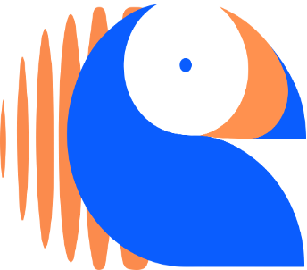
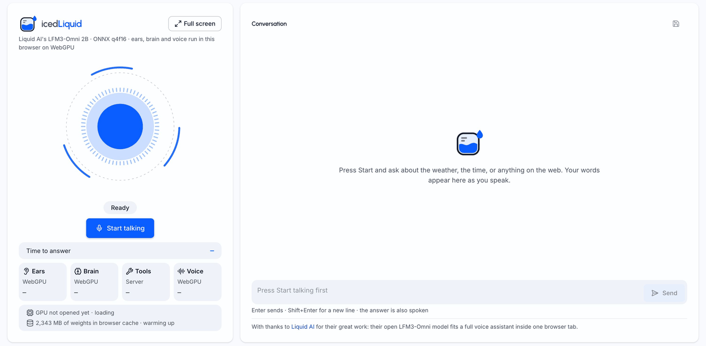
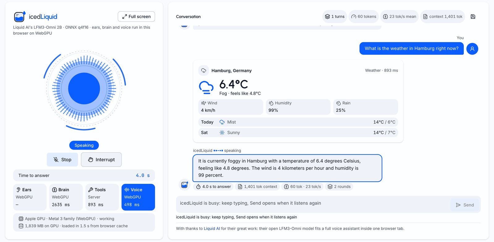
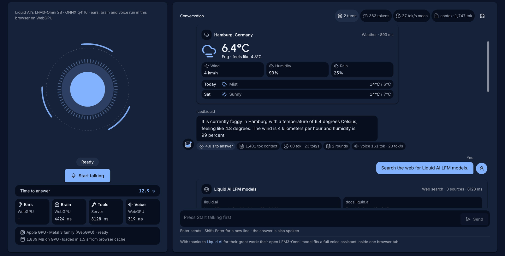
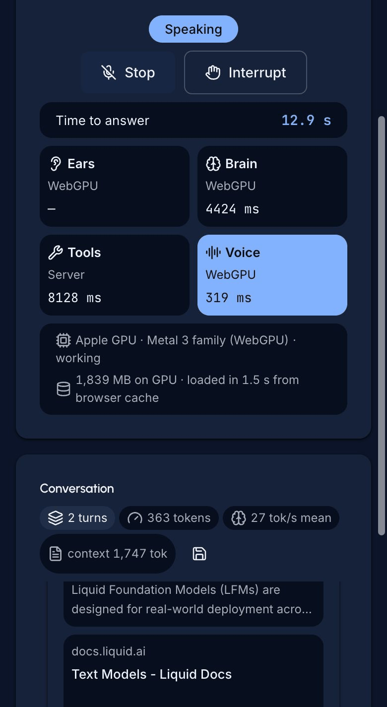

<!-- © 2026 Dudoxx UG / Acceleate Consulting - Walid Boudabbous <walid@acceleate.com> -->
<p align="center">
  <a href="https://www.dudoxx.com">
    
  </a>
</p>

<h1 align="center">icedLiquid</h1>

<p align="center">
  <strong>A voice assistant that listens, thinks and speaks inside your browser tab.</strong><br/>
  <em>Built on LFM3-Omni by <a href="https://www.liquid.ai">Liquid AI</a>. All model work runs on WebGPU, on your own machine.</em>
</p>

<p align="center">
  By <strong>Walid Boudabbous</strong> — <a href="https://www.dudoxx.com">Dudoxx UG</a> / <a href="https://www.acceleate.com">Acceleate Consulting</a><br/>
  <a href="https://www.linkedin.com/in/walid/">LinkedIn</a> · <a href="https://github.com/Walid-Azur">GitHub</a> · <a href="docs/ABOUT.md">About the author and the companies</a>
</p>

<p align="center">
  <a href="#status"></a>
  <a href="#license"></a>
  <a href="https://www.dudoxx.com"></a>
</p>

---

## What it is

icedLiquid is a small Next.js app with one screen: a voice assistant.
You press **Start talking**, ask a question, and icedLiquid answers out loud.

- **Ears, brain and voice run in the browser.** The LFM3-Omni model by
  [Liquid AI](https://www.liquid.ai) (ONNX, q4f16) runs on WebGPU in the tab.
  Speech recognition, the answer and the spoken reply never leave your machine.
- **Tools run on your local server.** Weather, time, web search and image
  generation are server routes. Your API keys stay on the server and never
  reach the browser.
- **Runs without keys, and says so.** Every tool that needs a paid key has a
  visible demo mode. The tool card shows a **Demo** badge and the agent tells
  you that the answer comes from demo mode. It never presents demo data as live.
- **Four languages.** English, German, French and Spanish. You can also say
  "speak German" to switch.
- Light and dark theme, a full-screen stage, barge-in (talk over it to
  interrupt), and a typed chat input.

The model weights are not in this repository. One command downloads them
from Hugging Face (see [Quick start](#quick-start)).

## Screenshots

| Light, ready | Light, weather answer |
|---|---|
|  |  |

| Dark, full screen | Dark, mobile |
|---|---|
|  |  |

## Showcase

The `showcase/` folder holds the public write-ups of this project.

| Item | What it is |
|---|---|
| [showcase/manual/index.html](showcase/manual/index.html) | Narrated motion manual (about 7 minutes, English voice). Open it from a local clone in Chrome or Edge, from `file://`. GitHub shows only its source, it does not play it. |
| [showcase/deck/index.html](showcase/deck/index.html) | Animated deck in one HTML file. It also opens from a local clone. |
| [showcase/deck/icedliquid-deck.pptx](showcase/deck/icedliquid-deck.pptx) | The same deck as an editable PowerPoint file. |
| [showcase/article/icedliquid-article.pdf](showcase/article/icedliquid-article.pdf) | The R&D article: realtime speech recognition, the tool agent, speech output, localization and turn-decision models. |

## What we learned

These findings come from the R&D article. Every figure is from one Mac and one
browser profile. They are not fleet numbers.

- **The model does not stream speech recognition.** A probe that timestamped
  every message on the wire saw 0 transcript deltas before the audio commit.
  Live captions had to be built around a batch encoder.
- **Pseudo-streaming works.** The page re-sends the growing utterance every
  500 ms, and a word is stable once 2 passes agree. On the server bench the
  first interim text came at 455 ms (p50) and the final text 211 ms (p50)
  after the pause.
- **The browser speech lane failed first, then passed a replay.** On live
  microphone audio it returned text in 0 of 7 passes. A replay of a real
  microphone capture then passed. The root cause of the first failure is
  still not recorded.
- **Give the model a real tool interface.** Tool specs written by hand into
  the system turn scored 16/20 calls (80.0 %). With the engine's own `tools`
  field, the right call came in 100.0 % of cases at N=100, on lenient grading
  of short English single calls.
- **A 2B model needs deterministic code around it.** It said it had switched
  to dark mode and did nothing, so phrase lists now drive theme, language and
  goodbye. It also invents numbers. A grounding guard blocks digits when no
  tool ran, but it cannot see a time written as words ("seven thirty").
- **Browser memory is the hard limit.** Cache Storage refused the decoder file
  of more than 1 GB, so the weights live in the Origin Private File System.
  The renderer peaked at 2916 MB and the GPU process at 4756 MB.
- **One recorded session, 12 answered turns.** The median reply started
  1121.1 ms after the question (p90: 2976.0 ms). The brain wrote at 14.4 tok/s.
- **Quantization can break a turn model.** An open turn-decision model
  exported to ONNX with exact full-precision parity. Naive int8 failed; only
  half precision with full-precision layer norms kept parity.

The full record, with what is still open, is in the
[article](showcase/article/icedliquid-article.pdf).

## Requirements

| You need | Why |
|---|---|
| Desktop **Chrome** or **Edge**, current version, with **WebGPU** on | The model runs on WebGPU. Check `chrome://gpu`. |
| **Apple Silicon** Mac, or a PC with a discrete GPU | The model needs a capable GPU and enough GPU memory. |
| About **2.5 GB** free disk, plus the same again in browser storage | Weights on disk (server) and a copy in the browser cache (OPFS). |
| **Node.js 24** or newer (see `.nvmrc`) | Runs Next.js and the download script. |
| **pnpm** (version pinned in `package.json`; `corepack enable` gets it) | Installs the packages. |
| A microphone | The agent listens to you. You can also type. |

API keys are optional. See [Runs without keys](#runs-without-keys).

## Quick start

```bash
git clone https://github.com/Dudoxx/icedliquid.git
cd icedliquid
pnpm install
cp .env.example .env.local
pnpm models:provision
pnpm dev
```

Then open **http://localhost:3400/en/voice-agent** in Chrome or Edge.

1. `pnpm install` installs the packages.
2. `cp .env.example .env.local` creates your local settings file. Add keys
   now or later (see [Environment keys](#environment-keys)).
3. `pnpm models:provision` downloads the voice model set (16 files, about
   2.45 GB) from Hugging Face at a pinned revision into `models/webgpu-onnx/`.
   It checks the sha256 of every file. Run it again to resume or repair; it
   keeps files that are already correct.
4. `pnpm dev` starts the app on `127.0.0.1:3400` (this computer only). It first copies the
   onnxruntime-web runtime files into `public/ort/`.
5. On the first visit the browser loads the weights from your server into its
   own cache. The next visits start from that cache.
6. Press **Start talking** and allow the microphone.

Other languages: `/de/voice-agent`, `/fr/voice-agent`, `/es/voice-agent`.

Production build and hosting: see [INSTALLATION.md](INSTALLATION.md).

## Runs without keys

icedLiquid runs end to end with no API key. Every paid tool has a visible demo
mode: the tool card shows a **Demo** badge, the result names the missing key,
and the agent says out loud that the answer comes from demo mode.

| Tool | With its key | Without its key |
|---|---|---|
| `web_search` | Exa web search | Searches the bundled `knowledge/` text about Dudoxx, Acceleate, Liquid AI, LFM3 and icedLiquid |
| `get_weather` | WeatherAPI.com | Real forecast from the keyless Open-Meteo API; the card names the source |
| `generate_image` | OpenRouter image model | A bundled Dudoxx demo image, marked as demo |
| `get_time` | needs no key | unchanged |

How each tool works, and how to plug in your own tool with locale-aware
descriptions and instructions: [docs/TOOLS.md](docs/TOOLS.md).

## Environment keys

All keys live in `.env.local`. They are read only on the server. Every key is
optional; an empty value means "not set".

| Key | Used by | Without it |
|---|---|---|
| `WEATHER_API_KEY` | `get_weather`, and `get_time` for a place ([WeatherAPI.com](https://www.weatherapi.com/signup.aspx)) | Weather in demo mode (Open-Meteo). |
| `WEATHER_API_BASE_URL` | WeatherAPI base URL | `https://api.weatherapi.com/v1` |
| `EXA_API_KEY` | `web_search` ([Exa](https://dashboard.exa.ai)) | Web search in demo mode (bundled knowledge). |
| `EXA_BASE_URL` | Exa base URL | `https://api.exa.ai` |
| `OPENROUTER_API_KEY` | `generate_image` ([OpenRouter](https://openrouter.ai/keys)) | Image generation in demo mode (bundled image). |
| `OPENROUTER_BASE_URL` | OpenRouter base URL | `https://openrouter.ai/api/v1` |
| `MODELS_DIR` | Folder the model route serves the weights from | `models/webgpu-onnx` in this repo |
| `ALLOWED_HOSTS` | Extra host names the tools route accepts, comma separated ([details](docs/CONFIGURATION.md#server-environment-guards)) | Only `localhost`, `127.0.0.1` and `[::1]` |

A tool without its key answers in demo mode and says so. A malformed URL
value stops the server at start and names the key.

`pnpm models:provision` does not read `.env.local`. It reads `MODELS_DIR` and
`HF_TOKEN` (only needed if Hugging Face asks you to sign in) from your shell:

```bash
MODELS_DIR=/data/icedliquid-models pnpm models:provision
```

If you change the folder, set the same `MODELS_DIR` in `.env.local` so the
server finds the files.

Model, voice and behaviour settings are in `config/icedliquid.json`. Every key
is explained in [docs/CONFIGURATION.md](docs/CONFIGURATION.md).

## Troubleshooting

| You see | Do this |
|---|---|
| The GPU line under the stage never says ready, or shows a WebGPU error | Open `chrome://gpu` and look for "WebGPU: Hardware accelerated". Update Chrome or Edge and your GPU driver. If it is off, turn on hardware acceleration in the browser settings. icedLiquid is built and tested for desktop Chrome and Edge. |
| A model file answers 404 `MODEL_FILE_MISSING` | The weights are not downloaded. Run `pnpm models:provision`. If you use `MODELS_DIR`, give the script the same folder as `.env.local`. |
| The download stops or a sha256 check fails | Run `pnpm models:provision` again. It keeps the good files and fetches the rest. |
| Browser storage is full, or loading fails after an update | The weights are cached in the browser (OPFS). Free disk space, or clear the site data: DevTools > Application > Storage > **Clear site data**. Then reload. |
| No microphone prompt, or the mic stays silent | Allow the microphone for the site (lock icon in the address bar), and check the input device in your system settings. |
| Mic and WebGPU do not work on `http://<your-ip>:3400` | Browsers allow the microphone and WebGPU only in a secure context: `http://localhost` or HTTPS. Use `localhost`, or serve the app over HTTPS (see [INSTALLATION.md](INSTALLATION.md)). |
| A tool card shows **Demo** | The tool has no key and runs in demo mode. Add the matching key to `.env.local` (see the table above) and restart `pnpm dev`. |
| A tool call answers 403 `CROSS_ORIGIN` | The tools route accepts only same-origin calls. Behind a reverse proxy, forward the original `Host` header. |
| `copy-ort-assets: cannot read ...` at start | Run `pnpm install` first. |

## Project layout

```
config/icedliquid.json   model, voice and tool settings
messages/<locale>/       UI text (en, de, fr, es)
scripts/                 provision-models.mjs, copy-ort-assets.mjs
src/app/[locale]/        pages (voice-agent)
src/app/api/             agent-tools/[tool] and models/[...file] routes
src/lib/webgpu/          in-browser ONNX engine (worker, cache)
src/lib/voice-agent/     listen / think / speak loop
knowledge/               bundled text for keyless web search
docs/                    configuration, tools, branding, about, screenshots
showcase/                manual, deck and R&D article
```

## Status

Alpha. One screen, one model, desktop browsers with WebGPU. Issues and pull
requests are welcome: see [CONTRIBUTING.md](CONTRIBUTING.md).

## Thanks to Liquid AI

icedLiquid exists because [Liquid AI](https://www.liquid.ai) builds open,
device-native models and publishes them with care. LFM3, the latest
generation of their Liquid Foundation Models ("LFM V3"), brings text,
vision, audio, omni and decision models onto one shared backbone, with open
weights in the 2B range. Its omni member, LFM3-Omni, listens, thinks and
speaks in one model. Its ONNX export is small enough to run on WebGPU.

That is what made this project possible: a full voice assistant, with
speech recognition, a tool-calling agent and a spoken reply, inside one
browser tab and with no inference server. The model card, the samples and
the chat templates answered most of our questions. The parts we got wrong
were ours. Thank you to the whole Liquid AI team.

- Liquid AI: https://www.liquid.ai
- Their models (LFMs): https://www.liquid.ai/models
- The LFM3 announcement: https://www.liquid.ai/blog/lfm3
- The model this app uses: [LiquidAI/LFM3-Omni-2B-ONNX](https://huggingface.co/LiquidAI/LFM3-Omni-2B-ONNX)

icedLiquid is an independent project by Dudoxx UG. It is not a Liquid AI
product and is not endorsed by Liquid AI. Branding rules:
[docs/BRANDING.md](docs/BRANDING.md).

## About Dudoxx

[Dudoxx UG](https://www.dudoxx.com) is an AI healthcare software company in
Hamburg, Germany. It builds the Dudoxx FHIR Clinic Platform: an AI-first
clinic management system with role-based portals, a FHIR R4 clinical core,
voice intake and telemedicine. Its AI runs self-hosted, on the clinic's own
servers or in a managed EU cloud. icedLiquid is a Dudoxx R&D project on
on-device voice AI.

## About Acceleate Consulting — R&D and work domains

[Acceleate Consulting](https://www.acceleate.com) is a technology consulting
practice based in Tallinn, Estonia: "Where AI Vision Meets Execution". It
works from strategy to delivery in four domains:

- **Applied AI:** custom LLM solutions, retrieval-augmented generation (RAG),
  speech systems, self-hosted inference and AI-powered automation.
- **Healthcare digitalization:** physician-led AI projects, medical
  documentation systems, telemedicine.
- **Fintech:** digital banking platforms and payment processing.
- **Enterprise:** ERP integration with AI, enterprise architecture, cloud.

Its R&D work, like this project, tests what small open models can do on
local hardware and publishes the measured results.

More about the author and both companies: [docs/ABOUT.md](docs/ABOUT.md).

## License

The code is licensed under the [Apache License 2.0](LICENSE). See [NOTICE](NOTICE).

The LFM3-Omni model weights are **not** in this repository and are **not**
under Apache-2.0. They keep their own license, the LFM Open License v1.0,
named on the [Hugging Face model card](https://huggingface.co/LiquidAI/LFM3-Omni-2B-ONNX).
Read it before you use or ship the weights.

---

<p align="center">
  <a href="https://www.dudoxx.com"></a><br/>
  <sub>© 2026 Dudoxx UG / Acceleate Consulting - Walid Boudabbous</sub>
</p>
